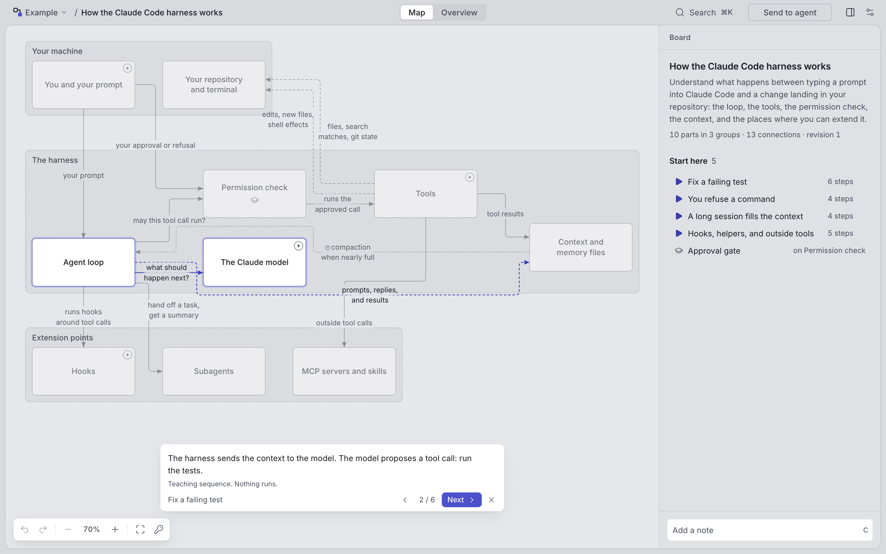

<div align="center">

# Anatomy

### Your coding agent knows your code. Now you can see what it knows.

[Try it](https://snitilf.github.io/Anatomy/) · [How it works](#how-it-works) · [Quick start](#quick-start) · [Docs](#documentation)

<picture>
  <source media="(prefers-color-scheme: dark)" srcset="docs/images/map-dark.png">
  
</picture>

</div>

Anatomy is a local web app that shows an AI coding agent's explanation of a codebase as an interactive architecture diagram.

Your agent reads a codebase in seconds.
You get a wall of text back.

Anatomy turns that text into a map.
Every part is a card, every connection says what it carries, and every guess is marked as a guess.
Walk through it, poke holes in it, draw on it, and send your questions straight back to the agent.
The map gets better each round.

It runs on your machine, in your browser.
No accounts, no cloud, no telemetry, and no AI inside the app.
Your agent does the thinking, and Anatomy shows it.

## Under the hood

- Layout: dagre computes the layers, and a custom orthogonal edge router draws the lines (`src/layout/autoLayout.ts`, `src/canvas/routing.ts`).
- Board format: the board is a Zod schema (`src/board/schema.ts`).
  The JSON Schema is generated from it, and CI fails when the checked-in copy is out of date.
- Command line: a bundled Node tool (`bin/anatomy.ts`) validates boards and applies patches.
  Anatomy writes it into your project as `.anatomy/anatomy.mjs`.
- No network: the built app ships a Content Security Policy (`connect-src 'none'`) that blocks fetch, WebSocket, and every request to another origin, so the page can load only its own files.
- State: undo and redo for the last 100 steps.
  Your marks are saved to IndexedDB, or to `.anatomy/layer.json` when a folder is open.
- Tests: 1,500+ unit tests with Vitest and 300+ browser tests with Playwright in Chrome.

## How it works

1. Start Anatomy and open it in Chrome or Edge (see [Quick start](#quick-start)).
2. Click **Open folder** and pick your project.
3. Click **Copy prompt**.
   Anatomy writes `.anatomy/README.md` into your project: a short page that teaches your agent the rules, with topics in `.anatomy/guide/` that it reads when it needs them.
   It also writes `.anatomy/anatomy.mjs`, a script your agent can run to check the board before it hands it over and to revise it with a short patch.
   When you open a folder that already has a board, Anatomy writes any of these files that are missing and refreshes the ones it wrote before.
   It leaves a file alone when you removed its Anatomy marker, which is the first line, or for the schema the `$comment` key.
4. Paste the prompt into your coding agent and finish the sentence:

   ```text
   Read .anatomy/README.md, then write .anatomy/board.json that explains: how a refund gets approved
   ```

   The map appears as soon as the agent writes the file.
5. Mark it up with notes, questions, your own links, and drawings.
   Click **Send to agent**, then give your agent the prompt it shows:

   ```text
   Read .anatomy/feedback.json and answer every item in the next revision of .anatomy/board.json. The format is in .anatomy/README.md.
   ```

   Until the agent writes back, the button reads **Waiting for the agent**.
   A banner at the top of the map then says what arrived, for example "Revision 2: 5 answers, 1 new part, 1 changed part.", with a **Review** button, and the title of the browser tab counts it while you are in another tab.
   The answers appear next to your marks.
   The map holds still: what the agent added, changed, or removed is marked on it until you mark the revision reviewed.
   A changed part shows its words before and after in its details.
   A file that is not a valid board, or whose revision is not higher, is not opened, and a quiet warning says why.

Commit `.anatomy/board.json` with the code it explains.
Add `.anatomy/layer.json` and `.anatomy/feedback.json` to `.gitignore`, because they hold your own working state.
Add `.anatomy/anatomy.mjs`, `.anatomy/patch.json`, and `.anatomy/board.prev.json` as well.
Anatomy writes the script again each time you open the folder, so a teammate who clones the repository gets it too.
The other two are the last patch and the board before it.

No agent at hand?
Open a built-in example: How the Claude Code harness works, Anatomy itself, or How a large language model like Opus 5.5 works.

## What you get

- A map that lays itself out, from left to right, with lines that route around the cards.
- A big board that folds into its groups when you zoom out, with one bundled line for each pair of groups.
- Walkthroughs that play a journey step by step, one highlight at a time.
- Honest sources: each claim says if the user said it, the agent read it, a plan states it, or the agent proposes it and nobody decided it yet.
- An Overview page that opens on the goal, the scope, and where to start, then lists every part, connection, and open question.
- A whiteboard on top: pen, shapes, arrows, text, sticky notes, and parts you propose.
- A Review tab with every answer from your agent, plus undo and redo for your last 100 steps.
- Light and dark themes, a command menu on <kbd>⌘</kbd> <kbd>K</kbd> or <kbd>Ctrl</kbd> <kbd>K</kbd>, and full keyboard control.

Boards are data, never code.
Anatomy never runs a script, opens a URL, or renders HTML from a board file.

## Quick start

You need Node.js 24 or later, which includes npm.

1. Clone the repository and install the packages:

   ```sh
   git clone https://github.com/snitilf/Anatomy.git
   cd Anatomy
   npm install
   ```

2. Start the app:

   ```sh
   npm run dev
   ```

3. Open http://127.0.0.1:5173.

If you use Chrome or Edge, you can open a project folder.
In other browsers, open a board file or a built-in example.

To try it without installing anything, open the [hosted copy](https://snitilf.github.io/Anatomy/).
It is the same app.
Nothing leaves your machine: the page loads only its own files, and your work stays in your browser or in your folder.
See [the hosted copy](docs/architecture.md#the-hosted-copy) for what it does.

## Documentation

- [Board format](docs/board-format.md): every field of a board file, and every check Anatomy runs on it.
- [Authoring guide](docs/authoring-guide.md): the rules your agent follows when it writes a board.
- [Architecture](docs/architecture.md): how the app lays out the map, stores your work, and keeps your files safe.

## Working on Anatomy

| Command | What it does |
| --- | --- |
| `npm install` | Installs the packages. |
| `npm ci` | Installs the exact versions in `package-lock.json`, as CI does. |
| `npm run dev` | Starts the dev server on `http://127.0.0.1:5173`. |
| `npm run build` | Type-checks and builds the static app into `dist/`. Every file is addressed relative to the page, so the same build runs from a folder, from the root of a server, and from a subpath. |
| `npm run preview` | Serves the built app on `127.0.0.1`. |
| `npm run typecheck` | Runs the TypeScript compiler in strict mode. |
| `npm run lint` | Runs oxlint. |
| `npm test` | Runs the unit tests once with Vitest. |
| `npm run check` | Runs type-check, lint, and tests in sequence. |
| `npm run test:e2e` | Builds the app in the `e2e` mode and runs the browser tests with the installed Google Chrome. |
| `npm run test:browsers` | Runs the journey test in WebKit and Firefox. Run `npx playwright install webkit firefox` once first. CI does not run it. |
| `npm run schema` | Writes `schema/board.v1.schema.json` and the field list `schema/board.v1.fields.txt` from the Zod schema. Run it after a schema change. |
| `npm run outlines` | Writes `src/app/exampleOutlines.generated.ts` from `src/examples/*.board.json` so the start screen previews match the real boards. |
| `npm run anatomy -- <command>` | Runs the `anatomy` tool from the source, for example `npm run anatomy -- validate path/to/board.json`. See [Board format](docs/board-format.md#check-a-board-outside-the-app). |
| `npm run tokens` | Prints the size of the generated agent README, each guide section and topic, each example board, and the output of the `anatomy` tool. |
| `npm run agent-files -- <folder>` | Writes the agent files into `<folder>/.anatomy/`, the way Copy prompt does. |
| `npm run eval` | Prints the evaluation tasks in `eval/` and scores a board file against them. |
| `npm run readme-images` | Builds the app and retakes the two pictures at the top of this file, `docs/images/map-light.png` and `docs/images/map-dark.png`, with Chrome. Options: `-- --example claude-code --walkthrough "Fix a failing test" --step 2 --out <folder>`. |

The dev and preview servers listen on the loopback interface only.

Each pull request and each push to `main` runs type checks, lint, unit tests, a production build, a schema freshness check, and Chrome end-to-end tests.
Run the frame-time gate locally before you merge: `npx playwright test e2e/performance.spec.ts --workers=1`.
Hosted CI reports that gate without enforcing it, because runner resources can distort frame timing.

To cut a release, follow [the release checklist](docs/release-checklist.md).
A tag that starts with `v` and matches `version` in `package.json` starts the release workflow.
That workflow runs every gate, then attaches a zip to the GitHub Release, with the notes from `docs/release-notes/<version>.md`.
The zip holds the built app, `serve.mjs` to run it with Node, and `README-run.txt`.

<details>
<summary>Stack</summary>

All versions are exact.
`.npmrc` sets `save-exact=true`, so new dependencies are also pinned.

| Package | Version | Purpose |
| --- | --- | --- |
| `react`, `react-dom` | 19.3.1 | UI |
| `@xyflow/react` | 12.12.1 | Canvas for cards and connections (React Flow, MIT core) |
| `zod` | 4.6.7 | Runtime validation of board files |
| `zustand` | 5.1.0 | App state store, read through selectors |
| `@base-ui/react` | 1.9.0 | Accessible menus, popovers, tabs, and tooltips |
| `cmdk` | 1.1.1 | The command menu and the searchable part pickers |
| `sonner` | 2.0.8 | Short confirmations |
| `clsx` | 2.1.1 | Conditional class names |
| `lucide-react` | 1.72.0 | Icons |
| `@dagrejs/dagre` | 3.1.3 | Layered layout of the cards (MIT) |
| `perfect-freehand` | 1.2.3 | Smooth outlines for pen lines on the whiteboard (MIT) |
| `@fontsource-variable/inter` | 5.3.0 | Inter, bundled with the app so no font loads from the network |
| `typescript` | 7.0.2 | Type checking, strict mode |
| `vite` | 8.3.8 | Dev server and build |
| `@vitejs/plugin-react` | 6.3.0 | React support for Vite |
| `vitest` | 5.1.0 | Unit tests |
| `jsdom` | 31.0.1 | Browser environment for tests |
| `@testing-library/react` | 16.3.3 | Component tests |
| `@testing-library/jest-dom` | 7.0.1 | DOM assertions for tests |
| `oxlint` | 1.93.0 | Linting |
| `ajv` | 8.20.0 | Tests the exported JSON Schema with an independent validator |
| `fake-indexeddb` | 6.2.8 | IndexedDB in unit tests |
| `@playwright/test` | 1.65.0 | Browser journey test |

Versions recorded on November 13, 2026.

</details>

## License

Anatomy is released under the [MIT License](LICENSE).

The approval-gate lesson uses the Anatomy kit by wheresryan22 (MIT).
Its license and source commit are in `src/lessons/kit/`.

The production dependencies are under the MIT, ISC, and BSD-3-Clause licenses as of November 13, 2026.
The Inter font is under the SIL Open Font License 1.1.
